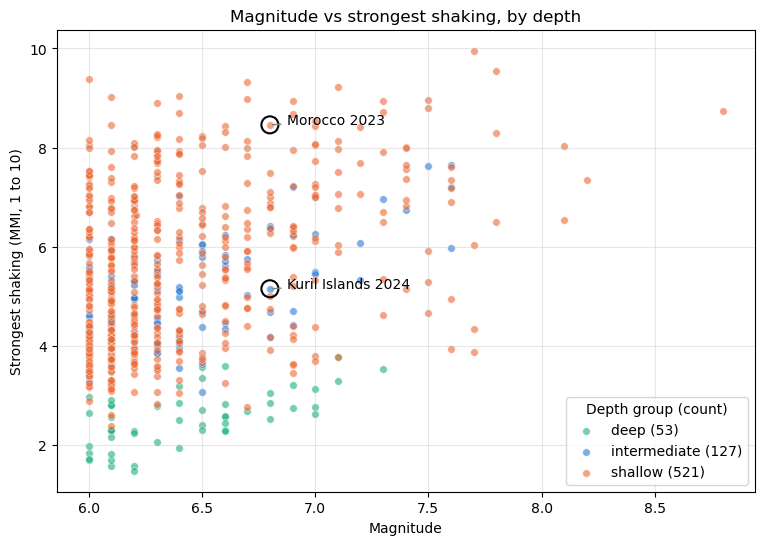
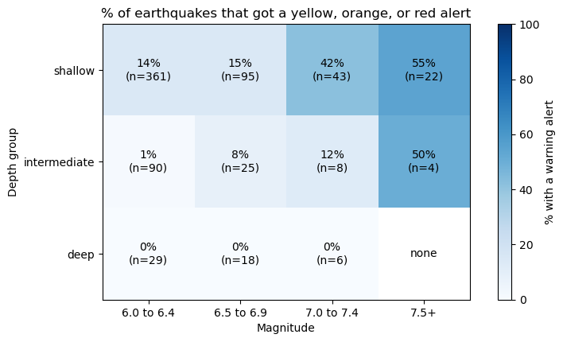
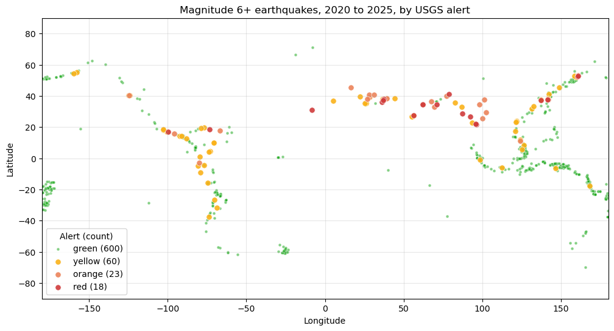
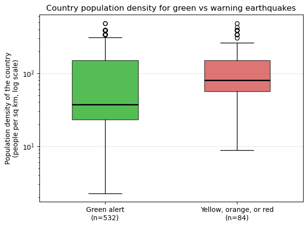

# Earthquake Damage Analysis

## Project Description

Same Size, Different Damage: Why Some Earthquakes Hit Harder Than Others.

A magnitude 6.8 earthquake near the Kuril Islands in December 2024 started 146 km underground, was felt by 3 people, and got a green USGS alert. A magnitude 6.8 earthquake in the Atlas Mountains of Morocco in September 2023 started about 19 km down, was felt by almost 2,000 people, and got a red alert. This project uses data to look at why two earthquakes of the same size can end so differently.

It uses every earthquake of magnitude 6.0 or higher from 2020 to 2025 (USGS Earthquake Catalog API) and country level facts about where each one hit (World Bank API). Two questions drive the work:

1. How much do magnitude and depth tell us about how strong the shaking is (a regression problem on MMI)?
2. Can we predict which earthquakes get a yellow, orange, or red USGS alert instead of a green one (a classification problem)?

This is an ongoing project for DS 3000 at Northeastern University. It is co-authored with Jaden (Minh) Pham from Phase II onward.

## Project Status

* Phase I, project proposal: done
* Phase II, proof of concept (data pipeline, cleaning, merging, charts, and model checking functions): done
* Phase III, final models: in progress. Linear regression for shaking, and a classifier such as k nearest neighbors or a decision tree for warning alerts

## Key Findings So Far

* 795 earthquakes were pulled from the USGS API. After cleaning, 701 remain, and 85.6% of them got a green alert (600 green, 60 yellow, 23 orange, 18 red).
* Depth matters as much as size. Correlation with shaking (MMI) is 0.36 for magnitude and negative 0.50 for depth.
* The two 6.8 examples show the gap. Morocco reached MMI 8.46 at 19 km deep, while the Kuril Islands reached MMI 5.16 at 146 km deep.
* No deep earthquake in the data got a warning. For shallow earthquakes, the warning rate goes from about 14 to 15% at magnitude 6.0 to 6.9, to 42% at 7.0 to 7.4, and 55% at 7.5 and up (only 22 earthquakes in that last group).
* Countries hit by warning earthquakes are more crowded. Median population density is 80.7 people per sq km for warning earthquakes and 37.2 for green ones (Welch t test on log density, t = 3.19, p = 0.0018).
* Baselines to beat in Phase III: a straight line on magnitude alone gives R squared of 0.13 and an MAE of 1.23 MMI points. Always guessing green is 85.6% accurate but catches none of the 101 warnings. A simple rule of "warning if MMI is 6.5 or higher" reaches 0.911 recall and 0.71 F1.

## Selected Charts

[](images/magnitude_vs_shaking_by_depth.png)

[](images/warning_rate_by_size_and_depth.png)

[](images/earthquake_map_by_alert.png)

[](images/population_density_boxplot.png)

## Data Used

* USGS Earthquake Catalog API: magnitude, depth, location, shaking (MMI), felt reports, significance, and PAGER alert for every earthquake of magnitude 6.0 or higher from 2020 to 2025
* World Bank API: population density and GDP per capita for each country, using the most recent year available between 2018 and 2024
* A saved snapshot of the USGS pull is included in `data/earthquakes_2020_2025.csv`

## Tools Used

* Python
* pandas and NumPy
* Matplotlib
* requests
* SciPy
* Jupyter Notebook

## Repository Structure

* `notebooks/01_project_proposal.ipynb`: the problem, the data source, first charts, and the plan for both questions
* `notebooks/02_phase2_proof_of_concept.ipynb`: API pulls, cleaning, merging with World Bank data, four charts, a t test, model checking functions, baselines, and ethical considerations
* `data/`: saved USGS snapshot and notes on the data
* `images/`: charts exported from the Phase II notebook
* `requirements.txt`: Python packages needed to run the notebooks

## How to Run

```
git clone https://github.com/nadim123189/Earthquake-Damage-Analysis.git
cd Earthquake-Damage-Analysis
pip install -r requirements.txt
jupyter notebook notebooks/02_phase2_proof_of_concept.ipynb
```

The notebooks call the USGS and World Bank APIs directly, so they need an internet connection and no API keys.

## Limitations

The USGS alert is itself the output of a model (PAGER), so predicting it means learning patterns in a prediction, not measuring real damage. Country averages for population density and GDP hide differences inside a country, and the code that pulls a country name out of the USGS place text still misses some names, so 616 of the 701 cleaned earthquakes match a World Bank country. USGS keeps revising shaking and alert values, so a fresh API pull can differ slightly from the saved snapshot. Results are for learning and research only, not for emergency decisions.
